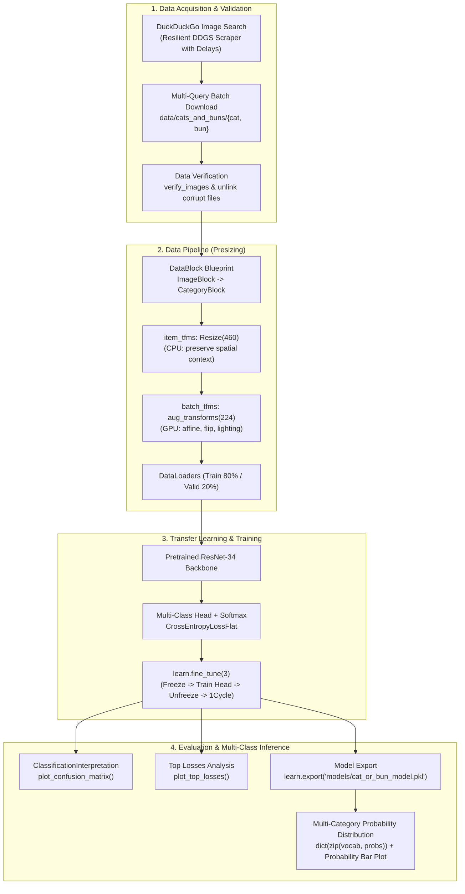

# Technical Design Document: Cat or Bun Image Classifier
**Project**: *Katzen oder Brötchen* (Coursework Image Classifier)  
**Methodology**: FastAI Multi-Class Probability Workflow (synthesizing *Is it a bird?*, *Fastbook Ch. 1 & 2*)  
**Status**: Ready for Execution  

---

## 1. Executive Summary & Objective

The objective of this project is to develop an educational, end-to-end computer vision notebook that classifies images into two visually confusing classes: **Cats** (especially curled up in a "cat loaf" pose) and **Buns** (cinnamon rolls, bread rolls, brioche).

Crucially, **the classifier is not treated as a binary Yes/No flag** (e.g., "Is it a cat? Yes"). Instead, it implements a **multi-class probability distribution model**: for any input image, it computes and displays the normalized Softmax probability distribution across all categories (e.g., `84.0% Cat, 16.0% Bun` or `98.2% Cat, 1.8% Bun`), visualized via formatted dictionary outputs and an intuitive horizontal probability bar chart.

The notebook synthesizes the best practices of Jeremy Howard's *Is it a bird?* Kaggle tutorial with the advanced data augmentation and diagnostics from Fastbook Chapters 1 and 2:
- **Scrapes data automatically** via DuckDuckGo with rate-limit resilience.
- **Validates and cleans** corrupted image files.
- **Implements Presizing**: high-resolution CPU resizing + GPU-accelerated batch augmentation.
- **Fine-tunes a pretrained ResNet-34** backbone using discriminative learning rates and the 1cycle policy.
- **Diagnoses errors** with a Confusion Matrix and Top Losses inspection.
- **Exports the trained model** for downstream inference.
- **Formats every step with a 3-part pedagogical structure**: Practical Goal, Core ML Concept, and Python/FastAI Implementation Details.

---

## 2. System Architecture & Data Flow



---

## 3. Directory Layout & File Organization

```
katzen-oder-broetchen/
├── README.md                          # Coursework overview
├── DESIGN.md                          # This Technical Design Document
├── requirements.txt                   # Local virtual environment dependencies
├── cat_or_bun_classifier.ipynb        # Primary educational Jupyter Notebook
├── data/
│   └── cats_and_buns/
│       ├── cat/                       # Scraped & verified cat images (~80-100)
│       └── bun/                       # Scraped & verified bun images (~80-100)
├── test_images/                       # Sample external images for inference testing
│   ├── sample_cat.jpg
│   └── sample_bun.jpg
└── models/
    └── cat_or_bun_model.pkl           # Exported FastAI Learner bundle
```

---

## 4. Key Design Components & Engineering Decisions

### 4.1 Multi-Class Probability Modeling (Softmax vs. Binary Threshold)
* **Design Principle**: While standard binary models often collapse output to a scalar probability `P(cat)` and a threshold (e.g. > 0.5), this project designs the system as a **generalized categorical classifier** using `CategoryBlock`.
* **Output Format**:
  - The final layer produces raw logits for each class in the vocabulary (`learn.dls.vocab` = `['bun', 'cat']`).
  - The model applies the **Softmax function**:
    $$\sigma(z)_i = \frac{e^{z_i}}{\sum_{j=1}^K e^{z_j}}$$
  - The inference helper formats results into a dictionary mapping class names to confidence percentages:
    ```python
    def predict_categories(img_path):
        pred, pred_idx, probs = learn_inf.predict(img_path)
        return {cat: f"{float(prob)*100:.1f}%" for cat, prob in zip(learn_inf.dls.vocab, probs)}
    ```
  - An accompanying visualization renders the input image side-by-side with a horizontal bar plot of category probabilities.

### 4.2 Resilient DuckDuckGo Scraper
* **Challenge**: Modern DuckDuckGo anti-bot protection throttles rapid repeated calls, and legacy `fastbook.search_images_ddg` is broken.
* **Solution**: 
  - Use `duckduckgo_search` context manager (`with DDGS() as ddgs:`).
  - Wrap search queries with explicit `time.sleep(3)` delays and retry handlers.
  - Curate 3 distinct sub-queries per category to capture the classic visual meme ambiguity:
    - **Cat sub-queries**: `'cat photo'`, `'curled up sleeping cat'`, `'cat loaf photo'`.
    - **Bun sub-queries**: `'bread bun photo'`, `'cinnamon roll bun'`, `'freshly baked bun roll'`.
  - Cap downloads to ~30 images per subquery (~90 per category total) to optimize download speed and training efficiency.

### 4.3 Presizing Data Augmentation (Fastbook Ch. 2 Best Practice)
* **Challenge**: Squishing images distorts cat and bun proportions; simple center cropping cuts out distinguishing visual features (ears, crust swirl).
* **Solution**:
  - `item_tfms = [Resize(460)]`: Initial CPU resize to larger bounding box, keeping aspect ratio.
  - `batch_tfms = [*aug_transforms(size=224, min_scale=0.75)]`: Batched GPU augmentations applying random resized crops, subtle perspective changes, rotations, and contrast variations in a single interpolation step to avoid pixel degradation.

### 4.4 Model Architecture: ResNet-34
* Pretrained on ImageNet (1.2M images, 1,000 classes), ResNet-34 provides 34 convolutional layers with residual skip connections.
* FastAI strips the final 1,000-unit linear layer and attaches a custom classification head: Adaptive Average Pooling, Adaptive Max Pooling, Flatten, BatchNorm, Dropout, Linear, ReLU, BatchNorm, Dropout, Linear(2 outputs).
* `learn.fine_tune(3)` implements two-phase training:
  1. Phase 1 (1 epoch): Frozen backbone, training only the custom head.
  2. Phase 2 (3 epochs): Discriminative learning rates (lower rates for early feature extractors, higher for the head) with cosine annealing (1cycle policy).

### 4.5 Diagnostics & Error Analysis
* **Confusion Matrix** (`ClassificationInterpretation.plot_confusion_matrix()`): Quantitative breakdown of True Positives, False Positives, and False Negatives.
* **Top Losses** (`plot_top_losses(k=4)`): Visual inspection of images with highest cross-entropy loss, revealing mislabeled web downloads or genuine ambiguous edge cases.

### 4.6 Portability & Dependencies
* **Dual-compatibility**: The notebook includes an optional top cell:
  ```python
  # Setup dependencies for Google Colab or Kaggle runtimes
  !pip install -Uqq fastai duckduckgo_search
  ```
* A local `requirements.txt` will pin:
  - `fastai>=2.7.14`
  - `torch>=2.0.0`
  - `torchvision>=0.15.0`
  - `duckduckgo_search>=6.0.0`
  - `pillow>=9.0.0`
  - `matplotlib`

---

## 5. Cell-by-Cell Notebook Blueprint

The notebook will be structured into explicit, numbered stages. Every code cell is preceded by an educational Markdown cell following the agreed 3-part layout:

### Cell 1 (Code): Environment Setup & Library Imports
* **Goal**: Install and import required computer vision, data manipulation, and web scraping packages.
* **ML Concept**: Reproducibility and dependencies in ML pipelines.
* **Python/FastAI Details**: `fastai.vision.all`, `duckduckgo_search.DDGS`, `pathlib.Path`, `matplotlib.pyplot`.

### Cell 2 (Markdown & Code): Resilient Image Scraping Function
* **Part 1 (Goal)**: Define a rate-limited web search function to retrieve image URLs from DuckDuckGo.
* **Part 2 (ML Concept)**: Dataset curation from uncurated web sources and rate-limiting ethics.
* **Part 3 (Python/FastAI Details)**: Context manager usage (`with DDGS() as ddgs:`), FastAI `L` collection, error catching, and polite throttling.

### Cell 3 (Markdown & Code): Multi-Query Dataset Download
* **Part 1 (Goal)**: Download and organize images into categorized directories (`cat` and `bun`).
* **Part 2 (ML Concept)**: Data variety (lighting, pose, angles) to prevent shortcut learning.
* **Part 3 (Python/FastAI Details)**: Directory creation with `Path.mkdir(exist_ok=True, parents=True)`, `download_images()`, polite throttling loop.

### Cell 4 (Markdown & Code): Image Validation & Pruning Corrupt Files
* **Part 1 (Goal)**: Scan downloaded image files and remove corrupt, truncated, or unreadable assets.
* **Part 2 (ML Concept)**: Data sanitization to avoid training runtime crashes and silent data degradation.
* **Part 3 (Python/FastAI Details)**: `get_image_files()`, `verify_images()`, and functional mapping `failed.map(Path.unlink)`.

### Cell 5 (Markdown & Code): DataBlock Definition & DataLoaders Construction
* **Part 1 (Goal)**: Assemble the data ingestion pipeline that loads images, applies labels, and splits train/validation subsets.
* **Part 2 (ML Concept)**: Categorical blocks, train/validation split (80/20) with fixed random seed for reproducibility, batch processing.
* **Part 3 (Python/FastAI Details)**: `DataBlock`, `blocks=(ImageBlock, CategoryBlock)`, `get_items=get_image_files`, `splitter=RandomSplitter(valid_pct=0.2, seed=42)`, `get_y=parent_label`.

### Cell 6 (Markdown & Code): Presizing and Data Augmentation Pipeline
* **Part 1 (Goal)**: Configure CPU presizing and GPU-accelerated batch transformations.
* **Part 2 (ML Concept)**: Data Augmentation as a regularizer, avoiding image degradation via single-step interpolation, affine transforms.
* **Part 3 (Python/FastAI Details)**: `item_tfms=Resize(460)`, `batch_tfms=aug_transforms(size=224, min_scale=0.75)`, and previewing using `dls.show_batch(max_n=8, nrows=2)`.

### Cell 7 (Markdown & Code): Vision Learner Initialization
* **Part 1 (Goal)**: Load the pretrained ResNet-34 model and initialize the FastAI `Learner`.
* **Part 2 (ML Concept)**: Transfer Learning, ImageNet feature reuse, replacing the classification head with a domain-specific linear classifier, error rate metric.
* **Part 3 (Python/FastAI Details)**: `vision_learner(dls, resnet34, metrics=error_rate)`.

### Cell 8 (Markdown & Code): Model Training (Fine-Tuning)
* **Part 1 (Goal)**: Execute the two-stage transfer learning fine-tuning procedure.
* **Part 2 (ML Concept)**: Freezing vs. unfreezing, discriminative learning rates, 1cycle learning rate policy (cosine annealing).
* **Part 3 (Python/FastAI Details)**: `learn.fine_tune(epochs=3, base_lr=2e-3)`.

### Cell 9 (Markdown & Code): Model Diagnostics — Confusion Matrix
* **Part 1 (Goal)**: Evaluate model classification accuracy across both classes on the validation set.
* **Part 2 (ML Concept)**: Confusion matrix interpretation (True Positives, False Positives, False Negatives), class balance evaluation.
* **Part 3 (Python/FastAI Details)**: `ClassificationInterpretation.from_learner(learn)`, `interp.plot_confusion_matrix()`.

### Cell 10 (Markdown & Code): Model Diagnostics — Top Losses Inspection
* **Part 1 (Goal)**: Inspect the validation samples where the model was least confident or made its most severe mistakes.
* **Part 2 (ML Concept)**: Hard negative mining, identifying noisy web labels and genuinely ambiguous samples (cats curled up like buns).
* **Part 3 (Python/FastAI Details)**: `interp.plot_top_losses(k=4, nrows=2)`.

### Cell 11 (Markdown & Code): Model Serialization & Export
* **Part 1 (Goal)**: Export the complete trained model (architecture, weights, vocabulary, transforms) to a portable pickle file.
* **Part 2 (ML Concept)**: Model artifacts, deployment readiness, inference decoupling.
* **Part 3 (Python/FastAI Details)**: `learn.export('models/cat_or_bun_model.pkl')`.

### Cell 12 (Markdown & Code): Multi-Class Probability Inference & Visual Display
* **Part 1 (Goal)**: Load the serialized model independently and predict the full probability distribution for every category on a novel test image, rendering a visual probability bar chart.
* **Part 2 (ML Concept)**: Softmax probability distribution vs. binary thresholding, interpreting relative confidence scores across classes.
* **Part 3 (Python/FastAI Details)**: `load_learner('models/cat_or_bun_model.pkl')`, `learn_inf.predict(PILImage.create(...))`, constructing `{category: probability}` mapping, and plotting with `matplotlib.pyplot.barh()`.

---

## 6. Verification & Acceptance Criteria

1. **Multi-Class Probabilities**: Predictions output explicit probabilities for each class (e.g. `84.0% Cat, 16.0% Bun`) with visual bar plotting rather than a binary True/False flag.
2. **Self-Contained Execution**: The notebook executes from top to bottom without manual file moving or missing dependencies.
3. **Resilience**: DuckDuckGo search queries execute without encountering unhandled rate limits.
4. **Data Integrity**: Corrupted image files are verified and purged before `DataBlock` ingestion.
5. **Model Performance**: ResNet-34 reaches >90% validation accuracy within 4 epochs (1 frozen + 3 fine-tuned).
6. **Artifact Generation**: The notebook successfully exports `models/cat_or_bun_model.pkl` and performs inference on an external sample image.
7. **Educational Completeness**: Every code block features the mandatory 3-part Markdown cell explaining the Practical Goal, Core ML Concept, and Python/FastAI implementation details.
