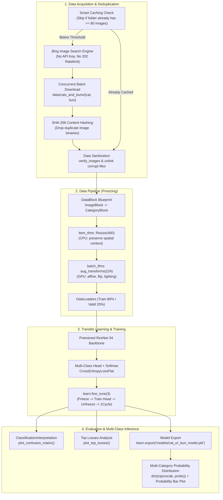

# Technical Design Document: Cat or Bun Image Classifier
**Project**: *Katzen oder Brötchen* (Coursework Image Classifier)  
**Methodology**: FastAI Multi-Class Probability Workflow (synthesizing *Is it a bird?*, *Fastbook Ch. 1 & 2*)  
**Status**: Ready for Execution / Updated with Resilient Scraper & Content Hashing  

---

## 1. Executive Summary & Objective

The objective of this project is to develop an educational, end-to-end computer vision notebook that classifies images into two visually confusing classes: **Cats** (especially curled up in a "cat loaf" pose) and **Buns** (cinnamon rolls, bread rolls, brioche).

Crucially:
1. **Multi-Class Probability Distribution**: The classifier is not treated as a binary Yes/No flag. For any input image, it computes and displays the normalized Softmax probability distribution across all categories (e.g., `84.0% Cat, 16.0% Bun`), visualized via formatted dictionary outputs and an intuitive horizontal probability bar chart.
2. **Resilient Data Acquisition**: Rather than relying exclusively on DuckDuckGo (which is prone to HTTP 202 rate-limiting), the pipeline uses a resilient web scraper powered by Bing image search with browser-like headers (and DDGS fallback) requiring zero API keys.
3. **Smart Caching & Idempotence**: A threshold-based caching mechanism (`TARGET_IMAGES_PER_CAT = 80`) with a `force_redownload = False` toggle skips re-downloading if sufficient images already exist locally, enabling fast and safe repeated notebook executions.
4. **Cryptographic Content Deduplication**: SHA-256 content hashing guarantees that identical image files are never stored or downloaded twice, even if returned under different query URLs.

---

## 2. System Architecture & Data Flow



---

## 3. Directory Layout & File Organization

```
katzen-oder-broetchen/
├── README.md                          # Coursework overview
├── DESIGN.md                          # This Technical Design Document
├── requirements.txt                   # Local virtual environment dependencies
├── cat_or_bun_classifier.ipynb        # Primary educational Jupyter Notebook
├── data/
│   └── cats_and_buns/
│       ├── cat/                       # Verified unique cat images (~80-90)
│       └── bun/                       # Verified unique bun images (~80-90)
├── testing_images/                    # External test images for inference validation
│   └── katzebroetchen.jpg             # User test image
└── models/
    └── cat_or_bun_model.pkl           # Exported FastAI Learner bundle
```

---

## 4. Key Design Components & Engineering Decisions

### 4.1 Resilient Search & Multi-Backend Ingestion
* **Challenge**: Modern DuckDuckGo anti-bot protection throttles rapid repeated calls with HTTP 202 rate limits.
* **Solution**: 
  - Primary scraper queries **Bing Image Search** using standard asynchronous image endpoints and browser headers (`Mozilla/5.0...`), which does not require API keys and is immune to DDG's 202 blocks.
  - Curated sub-queries per category to capture visual ambiguity:
    - **Cat sub-queries**: `'real cat photo'`, `'domestic cat photo'`, `'cat photo'`, `'curled up sleeping cat'`.
    - **Bun sub-queries**: `'bread bun photo'`, `'cinnamon roll bun'`, `'freshly baked bun roll'`, `'brioche bun photo'`.

### 4.2 Smart Caching & Cryptographic Hash Deduplication
* **Smart Caching**: Before making network requests, the pipeline inspects local directories. If a category already contains $\ge 80$ verified images, download queries for that category are safely skipped. A `force_redownload = False` toggle allows intentional cache-clearing when desired.
* **Content Hash Deduplication**: Search engines often return duplicate images across different URLs. The pipeline calculates the SHA-256 digest of each image's raw byte stream (`hashlib.sha256(chunk)`). Any newly downloaded file whose hash matches an already seen image is automatically deleted, ensuring strict dataset uniqueness.

### 4.3 Multi-Class Probability Modeling (Softmax vs. Binary Threshold)
* Rather than returning a binary scalar `is_cat: True/False`, the model uses `CategoryBlock` and computes normalized Softmax probabilities across all classes in `learn.dls.vocab` = `['bun', 'cat']`:
  $$\sigma(z)_i = \frac{e^{z_i}}{\sum_{j=1}^K e^{z_j}}$$
* Inference renders both a structured dictionary (`{'Cat': '84.2%', 'Bun': '15.8%'}`) and a horizontal bar chart visualizing class confidence.

### 4.4 Presizing Data Augmentation (Fastbook Ch. 2 Best Practice)
* `item_tfms = [Resize(460)]`: CPU resize to larger bounding box, keeping aspect ratio.
* `batch_tfms = [*aug_transforms(size=224, min_scale=0.75)]`: Batched GPU augmentations applying random resized crops, subtle perspective changes, rotations, and contrast variations in a single interpolation step to avoid pixel degradation.

### 4.5 Model Architecture: ResNet-34
* Pretrained on ImageNet (1.2M images, 1,000 classes), ResNet-34 provides 34 convolutional layers with residual skip connections.
* FastAI attaches a custom head: Adaptive Average Pooling, Adaptive Max Pooling, BatchNorm, Dropout, Linear, ReLU, BatchNorm, Dropout, Linear(2 outputs).
* `learn.fine_tune(3)` implements two-phase training (1 frozen epoch + 3 unfreezed epochs with 1cycle policy).

### 4.6 Diagnostics & Error Analysis
* **Confusion Matrix** (`ClassificationInterpretation.plot_confusion_matrix()`): Quantitative breakdown of True Positives, False Positives, and False Negatives.
* **Top Losses** (`plot_top_losses(k=4)`): Visual inspection of images with highest cross-entropy loss, revealing mislabeled web downloads or genuine ambiguous edge cases.

---

## 5. Cell-by-Cell Notebook Blueprint

Every code cell is preceded by an educational Markdown cell following the agreed 3-part layout:

### Cell 1: Environment Setup & Library Imports
* **Goal**: Install and import required packages (`fastai`, `hashlib`, `urllib`, `matplotlib`).
* **ML Concept**: Reproducibility and dependencies in ML pipelines.
* **Implementation**: `import fastai`, `from fastai.vision.all import *`, `import hashlib`.

### Cell 2: Resilient Image Search & Content Hashing
* **Goal**: Define `search_images()` (Bing image endpoint with browser headers) and `get_file_hash()` (SHA-256 digest).
* **ML Concept**: Web scraping ethics, avoiding bot detection, and cryptographic dataset deduplication.
* **Implementation**: `urllib.request.Request`, regex URL extraction, `hashlib.sha256()`.

### Cell 3: Smart Caching & Multi-Query Download Loop
* **Goal**: Download images across targeted sub-queries with duplicate elimination and caching check.
* **ML Concept**: Preventing redundant computation, data idempotency, and environmental diversity.
* **Implementation**: `TARGET_IMAGES_PER_CAT = 80`, `force_redownload` toggle, `download_images()`, hash-based pruning.

### Cell 4: Data Sanitization & Deduplication Pass
* **Goal**: Prune corrupted files (`verify_images`) and double-check dataset-wide uniqueness.
* **ML Concept**: Data sanitization to avoid training runtime crashes.
* **Implementation**: `verify_images()`, `failed.map(Path.unlink)`.

### Cell 5: DataBlock Definition & DataLoaders Construction
* **Goal**: Assemble data pipeline with train/validation split (80/20) and categorical labeling.
* **ML Concept**: Decoupled data ingestion, deterministic random split (`seed=42`).
* **Implementation**: `DataBlock(blocks=(ImageBlock, CategoryBlock), splitter=RandomSplitter(0.2, seed=42))`.

### Cell 6: Presizing & Data Augmentation Inspection
* **Goal**: Verify batch augmentation visually.
* **ML Concept**: Fastbook Presizing (CPU `Resize(460)` + GPU `aug_transforms(224)`) in single interpolation pass.
* **Implementation**: `dls.show_batch(max_n=8, nrows=2)`.

### Cell 7: Vision Learner Initialization
* **Goal**: Initialize ResNet-34 backbone with custom classification head.
* **ML Concept**: Transfer Learning, ImageNet feature reuse, error rate metric.
* **Implementation**: `vision_learner(dls, resnet34, metrics=error_rate)`.

### Cell 8: Model Training (Fine-Tuning)
* **Goal**: Execute two-stage fine-tuning.
* **ML Concept**: Freezing vs. unfreezing, discriminative learning rates, 1cycle cosine annealing.
* **Implementation**: `learn.fine_tune(epochs=3, base_lr=2e-3)`.

### Cell 9: Error Diagnostics — Confusion Matrix
* **Goal**: Evaluate classification accuracy and error directionality.
* **ML Concept**: Confusion matrix interpretation (TP, FP, FN).
* **Implementation**: `ClassificationInterpretation.from_learner(learn)`, `interp.plot_confusion_matrix()`.

### Cell 10: Error Diagnostics — Top Losses Inspection
* **Goal**: Inspect validation samples with the highest cross-entropy loss.
* **ML Concept**: Hard negative mining, discovering edge cases (cat loaf vs. cinnamon bun).
* **Implementation**: `interp.plot_top_losses(k=4, nrows=2)`.

### Cell 11: Model Serialization & Export
* **Goal**: Save trained model and transform pipeline to standalone pickle file.
* **ML Concept**: Model serialization, production decoupling.
* **Implementation**: `learn.export('models/cat_or_bun_model.pkl')`.

### Cell 12: Multi-Class Probability Inference & Visual Display
* **Goal**: Load exported model and compute Softmax distribution, plotting side-by-side with horizontal bar chart.
* **ML Concept**: Softmax probability distribution vs. binary thresholding.
* **Implementation**: `load_learner()`, `learn_inf.predict()`, horizontal bar plot rendering.

---

## 6. Verification & Acceptance Criteria

1. **Zero Rate-Limiting**: Bing-based image search executes smoothly without HTTP 202 or rate-limit blocks.
2. **Idempotent Caching**: Re-running the download cell when images exist skips downloading in <1 second.
3. **No Duplicate Hashes**: SHA-256 hashing guarantees zero identical image files exist across the dataset.
4. **Multi-Class Output**: Model outputs explicit probability percentages for all classes (`cat`, `bun`) with visual bar plotting.
5. **Self-Contained Execution**: All cells run reliably end-to-end.
